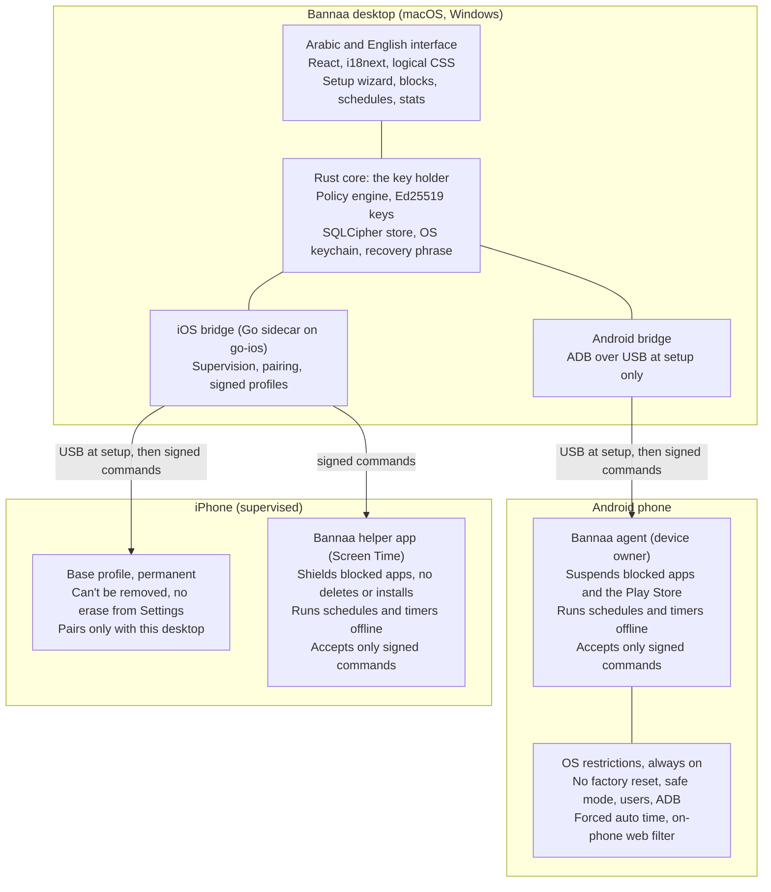
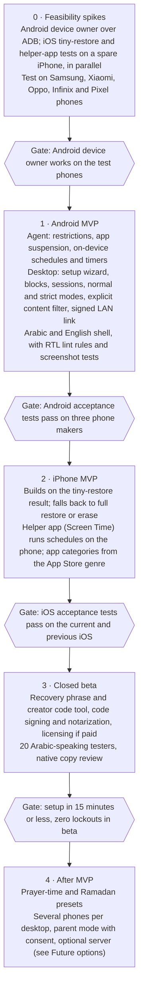

# Bannaa: Architecture Plan and MVP Scope

18 Oct 2026 · Yusuf  
Live version: https://claude.ai/code/artifact/92c68e04-ca3e-4611-99b7-1ebd14c61271

**Status: final MVP scope, agreed on 18 Oct 2026.** The only open question is whether Bannaa is free or paid.

## Summary

Bannaa (بنّاء) is an Arabic-first desktop app for Mac and Windows that locks distracting apps on the user's own phone. The phone alone can't undo the lock. It does this with the operating system's own management features: iOS supervision plus configuration profiles, and Android device-owner mode. A one-time USB setup makes the desktop the "key holder". After that, the phone obeys commands signed by that desktop, over USB or the home Wi-Fi.

Headline decisions:

- **Enforcement lives in the OS, not in an app the user can kill.** On Android, a device-owner agent applies policy and runs schedules on the phone itself. On iOS, a non-removable profile locks the phone down and a small Bannaa helper app runs schedules and blocks on the phone.
- **Fail closed.** A focus session or scheduled window ends only when its time runs out, and a manual block ends only by a signed unlock from the desktop. A dead battery, a reboot or a clock change never ends it early.
- **Local-first, no cloud in the MVP.** Keys, schedules and stats stay on the desktop and the phone. A 24-word recovery phrase (plus a kit file on iPhone) and creator-signed codes cover a lost computer.
- **Arabic is the primary language, not a translation.** The UI is RTL by default, with a full English (left-to-right) version at launch, Arabic type, Hijri dates, Arabic-region weekends, and prayer-time schedules as a later differentiator.
- **Android is built first.** It can be set up without wiping the phone and can enforce schedules offline. iPhone follows with the same features. Its setup uses a swappable supervision step, with a no-wipe tiny restore as the target.
- **Loosening is slow and never happens mid-block.** Every loosening waits out a cool-off delay, and nothing loosens during a focus session or schedule. At setup the user picks normal mode or strict mode, which stays on until the user asks to end it and then for 7, 30 or 90 more days.
- **Explicit content filter always on.** It runs at all times, separate from blocks. Setup shows that it is being turned on, but there is no option to skip it or turn it off later.

## Feature reference

The reference product ([shiftyourphone.com](https://shiftyourphone.com), read 16 Oct 2026) was used only for its feature set. The table gives each capability in our own terms and says what Bannaa does differently. None of its design, copy or branding is reused.

| Capability | What the reference offers | Bannaa approach |
| --- | --- | --- |
| Setup | Desktop app, phone over USB once, then wireless | Same model, with an Arabic step-by-step wizard that checks each step on the device |
| Platforms | iPhone, Android (iPad mentioned inconsistently) | Android first, then iPhone. iPad later |
| Blocking model | Fixed categories (social, games, news, video). The user can't re-allow them | Category presets on by default, plus the user's own block list. Any of them can be allowed after the cool-off. Strict mode locks everything until the user asks to end it, then for 7, 30 or 90 more days |
| Manual block | One tap to start | Start from the desktop or the phone. Ending it needs the desktop and waits out the cool-off |
| Focus session | 30, 60 or 90 min, or custom. It can't end early | 25, 50 or 90 min, or custom. Can't end early, even after a reboot or clock change |
| Schedules | Recurring windows that can't be lifted, even from the desktop | Weekly schedules plus a Ramadan or prayer-time preset (phase 2). Can't be lifted while running. Editing one outside a window waits out the cool-off |
| Uninstall protection | App can't be removed while blocking | Agent and profiles can't be removed at any time. Only the desktop can retire them, never during a block, and only after a wait of at least 24 hours |
| Websites | Distracting sites blocked | Site blocking with an Arabic-region list, plus an always-on explicit content filter |
| Allow requests | Request an app from the desktop, judged against the rules | MVP: the user allows it on the desktop with a cool-off delay, never during a focus session or scheduled window. Rules-based review later |
| Lost computer | Log in on another computer | Recovery phrase (plus a kit file on iPhone), two free restores, then creator-signed recovery codes, with no servers (see Recovery). Optional account sync later |
| Stats | "Time saved", next session | Blocked time, sessions completed, streaks, all local |
| Pricing | 3-day trial, then a one-time fee per device count | Open question (see the last section) |

## How enforcement works

Both platforms give one trusted controller the power to set policy that the person holding the phone can't change. Bannaa makes the user's desktop that controller. The only way left to escape is a full wipe of the phone, which costs far more than a distraction is worth.

### Android: device-owner agent

1. The user turns on USB debugging. The desktop installs the Bannaa agent APK over ADB.
2. Android allows `dpm set-device-owner` over ADB only when the phone has no accounts and no secondary users. So the wizard has the user remove their Google and phone-maker accounts for a moment, sets the owner, then they add them back. Nothing is wiped.
3. As device owner, the agent applies these at all times:
   - `DISALLOW_FACTORY_RESET`, `DISALLOW_SAFE_BOOT`, `DISALLOW_ADD_USER` and `DISALLOW_CONFIG_DATE_TIME`, plus auto time forced on.
   - `DISALLOW_DEBUGGING_FEATURES` once setup ends, so ADB can't be used to tamper with it.
   - `DISALLOW_INSTALL_UNKNOWN_SOURCES_GLOBALLY`, so a blocked app can't come back as a sideloaded copy.
   - A device-owner app can't be uninstalled or disabled, and `setUninstallBlocked` protects any other app the user chooses.
4. During a block, the agent calls `setPackagesSuspended` on the blocked apps. The Play Store is suspended too, so they can't be reinstalled. Websites are filtered on the phone by the agent's own always-on VPN in lockdown mode. It blocks listed sites during a block and sends every other lookup to a family-filter DNS, which is the explicit content filter. The same VPN forces SafeSearch in every browser by answering Google, Bing and DuckDuckGo lookups with their SafeSearch-only addresses (`forcesafesearch.google.com`, `strict.bing.com`, `safe.duckduckgo.com`). If the provider's list misses sites, Bannaa can add its own list on top, checked before a lookup is forwarded. The simpler fallback is `setGlobalPrivateDnsModeSpecifiedHost` (Android 10 and later), which can point at only one filtering resolver.
5. Schedules and timers run on the phone, from alarms that are re-armed at boot. The agent counts with the monotonic clock and saves state, so a reboot never resets a timer.

### iOS: supervision plus profiles

1. The desktop supervises the iPhone with its own supervision identity, which is a certificate created on first run. This is a **swappable setup step**, and everything after it is the same whichever method succeeds. The methods are tried in this order:
   1. **Tiny restore (target).** The user turns off Find My, which iOS requires for any restore from a computer. The desktop builds a minimal backup that holds only the supervision settings and restores just that. Apps, photos and data are never touched, and it takes a few minutes. This method is undocumented by Apple, and testing it on current iOS is the first iOS gate.
   2. **Full backup, modify and restore.** The desktop takes a full encrypted backup, adds the supervision settings and restores it. Data comes back, but it takes 10 to 60 minutes and needs free disk space.
   3. **Erase and supervise.** This is Apple's documented flow and always works. The user restores their data from a backup afterwards.
2. A permanent **base profile** is installed with `PayloadRemovalDisallowed`. Its restrictions (`com.apple.applicationaccess`) are: `allowUIConfigurationProfileInstallation=false`, `allowEraseContentAndSettings=false`, `allowHostPairing=false` (only the supervising desktop can pair), `forceAutomaticDateAndTime=true`, `allowEnablingRestrictions=false` and `allowVPNCreation=false`. It also turns on Apple's built-in adult-website filter, which is the explicit content filter on iPhone. It also locks the phone's DNS (`com.apple.dnsSettings.managed` with `ProhibitDisablement`, supervised only) to an encrypted family-filter resolver that forces SafeSearch on Google, Bing and DuckDuckGo in every browser. If needed, Bannaa's own list is added on top through the filter's deny list. The user then turns Find My back on.
3. A **block profile** is added when a block starts and removed when it ends. It carries `blockedAppBundleIDs` with the blocked list, `allowAppRemoval=false`, `allowAppInstallation=false`, and a web content filter that adds the blocked sites while keeping the adult-website filter on, since iOS applies one web filter at a time.
4. **Timing on iPhone: the Bannaa helper app.** iOS profiles have no clock, so an on-phone helper app does the timing. It uses Apple's Screen Time APIs (`DeviceActivity` and `ManagedSettings`) to start and end schedules and focus sessions on the phone itself, and to shield blocked apps, with no computer or Wi-Fi needed. As on Android, the desktop is needed only for setup and for loosening, and the helper accepts only commands signed by the desktop. It is a small, unlisted App Store app: hidden from search, opened from a QR code the desktop shows during setup, with one status screen. The block screen is Apple's, styled with Bannaa's text and colours. The base profile still does the lock-down. Plan B, if the helper isn't ready in time: the desktop times blocks by pushing the block profile over USB or home Wi-Fi. Blocks then start late when the desktop is off or away, and end only when it comes back. The first iOS test must confirm that, on a supervised phone, the user can't delete the helper or switch off its Screen Time access.

### What can still break it

| Attempt | Android | iOS |
| --- | --- | --- |
| Uninstall the blocker | Blocked (device owner) | Blocked (profile can't be removed) |
| Factory reset from Settings | Blocked | Blocked |
| Safe mode, new user, change the clock | Blocked | Not possible, or the clock is forced to auto |
| Reinstall a blocked app or install a clone | Store suspended, sideloading off | App installs off during a block |
| Pair with a friend's computer | ADB off | Host pairing off |
| Wipe via recovery mode or DFU on any computer | **Possible.** Erases the phone | **Possible.** Erases the phone |

The last row can't be closed by a consumer product, and Bannaa will say so plainly. The goal is that escaping costs a wiped phone.

## System architecture

There are three parts: the desktop app, which holds the keys, an Android agent that enforces on the phone, and, on iPhone, a permanent profile plus the Bannaa helper app. MVP has no server.

The desktop holds the keys; each phone enforces the block itself.

The Rust core is the only part that can loosen a block. Android enforces offline on its own. On iPhone the Bannaa helper app does the same, so neither phone needs the desktop after setup except to loosen.

**Ready for a server later.** The MVP has no server, but it is built so one can be added without redesign:

- **Commands don't care how they travel.** Every command is signed by the desktop and checked by the phone, so a server can relay them (for remote control away from home) without being able to forge or change them.
- **Recovery is a plug-in.** The creator's offline signing tool and a future self-service recovery server sign the same code format, and the phone can't tell the difference.
- **Versioned protocol and updatable agent.** Every message carries a version, and the desktop can update the agent from day one. Phones already in use can then learn new features, which is the part that's hardest to fix later.
- **Sync-ready data.** Rules, schedules and stats carry unique IDs and change times, so they can sync to an account later without migration.
- **Keys stay on the user's devices.** Even with a server, it would hold only encrypted data and relay messages.
- **The phone trusts a list of keys.** (Agreed 23 Oct.) The MVP caps the list at one key, the desktop's, so nothing changes for users. Later a server, a second computer or a parent's computer can be added without setting phones up again. Adding a key is a loosening: it needs the current desktop's signature, waits out the cool-off, and is refused during any block, window or strict mode. A restore or creator code replaces the list. No key holder can skip the policy gate.
- **The delivery route is swappable.** (Agreed 23 Oct.) USB at setup and home Wi-Fi after it are the first routes; a server can be added later as another route, with the same signed commands and checks. Each command's expiry and counter stop late or duplicate deliveries.

## Focus sessions, schedules and uninstall protection

All three are modes of one engine. A **block** is a set of blocked apps and sites, plus an end condition. That engine is the agent on Android and the helper app on iPhone (the desktop under plan B).

| Mode | Starts | Ends | Early exit |
| --- | --- | --- | --- |
| Manual block | One tap on the desktop or phone | A signed unlock from the desktop | Desktop only, after a cool-off delay (default 10 minutes) |
| Focus session | Desktop or phone, 25, 50 or 90 min, or custom | When the timer runs out | None. Fail-closed through reboots and clock changes |
| Schedule | Weekly windows, such as Sun to Thu 22:00 to 07:00 | At the window's end | None while the window runs. Editing or cancelling it happens only outside a window, after the cool-off |
| Uninstall protection | Always on after setup | Only by "Retire device" on the desktop | Refused during any block or window, or while strict mode is on. Otherwise it waits the longer of 24 hours or the cool-off |

Rules that keep it from being bypassed:

- **Loosening is slow, tightening is instant.** Adding an app to a block, starting a session or adding a schedule applies at once. Loosening covers removing or allowing an app, shortening or cancelling a schedule, lowering the cool-off and retiring the phone.
- **Cool-off delay.** Every loosening waits out a delay the user sets, from 0 minutes to 7 days (default 10 minutes). Delays longer than 7 days are what strict mode is for. Raising it applies at once. Lowering it is itself a loosening, so it waits out the current delay.
- **Nothing loosens during a window.** No loosening takes effect during a focus session or scheduled window. A request made then is held until the window ends.
- **Two modes, chosen at setup.** Normal mode (pre-selected) allows loosening after the cool-off. Strict mode is a commitment with no end date: nothing can be loosened while it is on. To leave it, the user asks the desktop to end strict mode, and the exit countdown picked at setup (7, 30 or 90 days) starts. Everything stays strict during the countdown, and the phone then returns to normal mode. Cancelling the request applies at once. A request made during a focus session or window starts counting when the window ends. The countdown length can be raised at once but never lowered while strict mode is on.
- **One policy gate.** Every loosening request passes through one check on the phone (cool-off, windows, strict mode). Future options such as an accountability-partner PIN or never-removable categories plug in there as extra checks (see Future options).
- **Signed commands.** Every unlock or loosening command is signed with the desktop's Ed25519 key and carries a counter and an expiry. The agent and the helper app reject replays and anything unsigned. The phone's own UI can only tighten.
- **Overlap resolves to the strictest.** When a session and a schedule overlap, the union of blocked apps applies until the later end.
- **Always allowed.** Phone calls, emergency calls, SMS, maps, banking, authenticators and Bannaa's own apps can never be blocked, so a block can't strand anyone.
- **Retiring a device** removes device owner (Android), or the profiles and helper app (iOS), and deletes the pairing. It is the only exit, and it needs the paired desktop. It is refused while any block, session or scheduled window is active or strict mode is on, and it waits the longer of 24 hours or the cool-off, so an impulse to quit passes before it takes effect.

### Recovery

The phone obeys only the computer holding its key, so a lost computer needs a way back that uses no servers. The creator (Bannaa's maker) can help, but can never unlock a phone alone.

1. **Recovery phrase and kit.** At setup the desktop shows a 24-word phrase, in Arabic or English. On Android the desktop's key is generated from the phrase, so the phrase alone restores it, and no file is needed. On iPhone the desktop also saves an encrypted recovery kit file holding the supervision ID, which can't be rebuilt from words. Setup doesn't finish until the user confirms the phrase.
2. **Two free restores.** On a new computer the user types the phrase, and on iPhone also picks the kit. A third restore is refused even with the correct phrase. The agent counts restores on the phone, where the user can't reset the count.
3. **Creator recovery codes after that, or when the phrase is lost.** The phone shows a request code built from its own ID and a fresh random number. The creator signs it with an offline master key and sends back an answer code.
   - The answer works only on that phone, only for that request, and only once. Shared or replayed codes are rejected.
   - With the phrase, the code allows another restore. Without the phrase, it lets the phone trust a new computer with a fresh key (re-keying).
   - The creator can issue as many codes over time as needed.
4. **A restore never loosens anything.** The new computer reads all rules from the phone. Nothing can loosen for 24 hours afterwards. A re-key also shows "A new computer is taking over" on the phone and waits a few hours first.
5. **The master key never leaves the creator's offline machine.** It is backed up in two safe places. If it leaked, anyone could make codes for any phone.

Creator codes work on Android in the MVP. On iPhone, re-keying without the phrase isn't possible without the original supervision identity, so iPhone uses the helper app instead: at setup the desktop locks the recovery kit and the 24 words inside the helper app with a random key unique to that phone. That key is itself locked with the creator's public key. In a recovery the app shows a short code, the creator returns that phone's unique key, and the user then runs the normal restore, so the counter, rule carry-over and waiting period still apply.

## Languages: Arabic first, English second

Arabic is the source language. Strings are written in Arabic first and English is the translation. The layout is built RTL from day one, never flipped at the end. English is a full second version at launch: because every screen uses start and end instead of left and right, switching to English flips the whole layout to left-to-right automatically.

- **Layout:** `<html dir="rtl" lang="ar">` by default. CSS uses logical properties only (`margin-inline-start`, `inset-inline-end`), enforced by a lint rule that bans `left` and `right`. Direction icons (back, next, progress) are mirrored. Clocks, media controls and brand logos are not.
- **Mixed text:** app names are mostly Latin ("Instagram", "TikTok"). Each one is wrapped in `<bdi>` so it never reorders the Arabic around it. Bundle IDs and package names are shown LTR inside RTL rows.
- **Type:** IBM Plex Sans Arabic or Noto Sans Arabic for the UI, both under the Open Font License and bundled, not loaded from the web. Line height is about 1.6 for Arabic, and letter-spacing is never applied to Arabic text.
- **Numbers and dates:** Western digits by default, since most Gulf and Egyptian users read them in apps, with Arabic-Indic digits as a setting. Formatting goes through `Intl` with `ar` locales. The Hijri calendar (`islamic-umalqura`) shows next to the Gregorian one in the schedule views.
- **Week and weekend:** the week starts on Saturday or Sunday by region. Weekday presets cover Friday-Saturday weekends (Gulf, Egypt) and Saturday-Sunday ones.
- **Arabic-region presets (phase 2):** prayer-time blocks computed on the device with the MIT-licensed `adhan` library from the user's city, a Ramadan schedule template, and a category list that includes popular regional apps and sites.
- **On the phone:** the Android block screen, notifications and agent UI follow the phone's language (Arabic or English, including Android's per-app language setting). The iPhone helper app does the same. iOS profile names and descriptions are written in the iPhone's language at install time and refreshed on the next profile update. The desktop follows the computer's language on first launch, with a switch in settings. Arabic is the fallback for any other language.
- **Dialect and tone:** UI copy uses clear Modern Standard Arabic with a warm, non-preachy tone. It is reviewed by a native copywriter (Egyptian for launch) so it reads naturally, and is never machine-translated.
- **Quality bar:** RTL screenshot tests for every screen, and a pseudo-locale that stretches strings by 30% to catch overflow.

## Tech stack

The recommendation is Tauri 2: a Rust core with a React UI, and a small Go sidecar for iPhone communication. The aim is a small installer, memory-safe crypto, and permissive licenses for every device library, so the app can stay closed-source.

| Layer | Choice | Why | Alternative |
| --- | --- | --- | --- |
| Desktop shell | Tauri 2 (Rust) | Installers around 10 MB, a Rust core for crypto and USB, a signed auto-updater | Electron: bigger, but a simpler Node ecosystem |
| Desktop UI | React, TypeScript, Vite, Tailwind logical utilities (`ms-`, `pe-`), i18next | Mature RTL support and a fast team ramp-up | SolidJS |
| iOS bridge | Go sidecar on [go-ios](https://github.com/danielpaulus/go-ios) (MIT) for pairing, profiles and app lists | Permissive license, works on Mac and Windows | libimobiledevice (LGPL, needs dynamic linking). pymobiledevice3 is GPL, so avoid it |
| Android bridge | ADB protocol in Rust, at setup only | Avoids shipping Google's platform-tools binary | Bundled `adb`, if the license review allows it |
| Phone link after setup | LAN with mDNS discovery and mutual TLS pinned to keys exchanged over USB | Works without the cable, no cloud | Optional server relay later (see Future options) |
| Android agent | Kotlin, Jetpack Compose (RTL built in), minSdk 26, Room, AlarmManager | Device-owner APIs, on-device schedules | None |
| iOS profiles | `.mobileconfig` built and CMS-signed in Rust with the supervision identity | No server needed | None |
| iOS helper app | Swift and SwiftUI with Apple's Screen Time APIs (FamilyControls, DeviceActivity, ManagedSettings). CryptoKit checks the desktop's signatures | Schedules and sessions run on the iPhone without the desktop | Plan B: the desktop times the block profile |
| Local data | SQLite (SQLCipher). Keys in macOS Keychain or Windows Credential Manager | Encrypted at rest | None |
| App categories | iOS: the public iTunes lookup API by bundle ID for the genre. Android: a curated JSON catalogue, updated in releases | Lets blocking follow categories without the user picking apps | None |
| Release | Apple Developer ID and notarization, App Store for the iPhone helper. Windows code signing (Azure Trusted Signing) | Stops Gatekeeper and SmartScreen warnings that scare users off | None |
| Marketing website | React, TypeScript, Vite, a static build on S3 behind CloudFront, deployed by GitHub Actions (added 25 Oct) | Cheap static hosting with no server code. Separate from the app: it never talks to the desktop or the phone | Any static host |

On Windows, iPhone USB needs Apple's driver, which comes with the "Apple Devices" app from the Microsoft Store. Bannaa can't bundle it, so the wizard detects it and links to it.

## MVP scope

The MVP is one phone and one computer, in Arabic and English, with blocking that holds on both Android and iPhone. Android is built and tested first. iPhone follows once the tiny-restore test settles its setup. Everything that needs a server or a second person waits.

**In the MVP**

- Desktop app for macOS (Apple silicon and Intel) and Windows 10/11, Arabic RTL with English as a second language.
- Setup wizard over USB for Android (device owner, no wipe) and iPhone (the swappable supervision step: tiny restore first, then full restore, then erase).
- Bannaa helper app for iPhone (Screen Time APIs), an unlisted, one-screen App Store app opened from a QR code during setup. It runs schedules and focus sessions on the phone without the desktop.
- Category blocking (social, short video, games, news, streaming) with presets on, plus the user's own blocked apps and sites.
- Manual block, focus sessions, weekly schedules, the cool-off delay, and normal or strict mode chosen at setup.
- Always-on explicit content filter, separate from blocks and on 24/7. In Arabic it is labelled «حجب المحتوى غير اللائق» with a one-line explanation. Setup shows a screen saying it is being turned on and takes effect on installation, with no checkbox to untick. SafeSearch is forced on Google, Bing and DuckDuckGo in every browser on both phones. On Android: a locked family-filter DNS (such as CleanBrowsing or Cloudflare 1.1.1.3) inside the agent's VPN, which also answers search lookups with SafeSearch-only addresses, Chrome managed settings that turn off its own secure DNS, and VPN setup blocked. On iPhone: the built-in explicit-content web filter and a locked family DNS that forces SafeSearch, both in the base profile. If the provider's list misses sites, Bannaa adds its own list on top. It can't be turned off from the desktop or the phone. Only retiring the phone removes it.
- Uninstall protection and anti-tamper restrictions from the enforcement section.
- Wireless control from the desktop on the same Wi-Fi after setup, for loosening and rule changes. Blocks themselves run on the phone.
- Block screen on Android and profile names on iOS, in Arabic or English to match the phone.
- Local stats: hours blocked, sessions completed, streak.
- Recovery phrase: 24 Arabic or English words that regenerate the desktop's key on Android. An encrypted recovery kit file is added only for iPhone. Two restores with the phrase, then creator-signed recovery codes (see Recovery).
- Licensing depends on the free-or-paid decision (see Open questions).

**Not in the MVP**

- Accounts, cloud sync, remote control away from home Wi-Fi.
- Parent mode and managing someone else's phone. Planned for a later phase (2 or 3), so the MVP keeps the door open: the data model already lets one desktop hold keys for several phones, and the setup flow has room for a consent step.
- Several phones per desktop, iPad.
- Prayer-time and Ramadan presets (first thing after MVP).
- Rules-based review of allow requests, rewards.

**Acceptance criteria**

- [ ] On Samsung, Xiaomi, Oppo and Infinix phones (common makers in Egypt, to confirm with market data), plus a Pixel, with a block running, none of these work: uninstalling the agent, resetting from Settings, safe mode, adding a user, changing the clock, installing a blocked app from the Play Store or an APK.
- [ ] On an iPhone running the current and previous iOS versions with a block running, none of these work: deleting a blocked app, removing either profile, erasing from Settings, pairing with another computer, installing a profile, deleting the helper app or switching off its Screen Time access.
- [ ] A 60-minute focus session survives a reboot, airplane mode and a dead battery, and ends within 60 seconds of its real end time.
- [ ] A schedule starts and ends within 60 seconds on Android with the desktop off. The same holds on iPhone, through the helper app.
- [ ] Setup takes 15 minutes or less for an Android user who has never done it, measured in testing with 5 Arabic-speaking users.
- [ ] Restoring with the 24 words (plus the kit file on iPhone) on a new computer regains control of the phone with no factory reset. On Android, a creator code regains control without the phrase, and any other phone, or a second use, rejects that code. A third restore without a creator code is refused.
- [ ] Every screen passes RTL screenshot review, with no clipped Arabic at 200% text size.
- [ ] A loosening request made during a focus session or window is held until it ends. One made during strict mode, including its exit countdown, is refused until strict mode ends.
- [ ] With the filter on, a known adult site doesn't load in Chrome or Safari, searches on Google, Bing and DuckDuckGo return SafeSearch results in any browser, and the filter can't be turned off from the phone or the desktop.

## Milestones

The plan opens with short feasibility spikes, because the no-wipe iPhone setup, the helper app and phone-maker quirks decide the rest. Each phase ends at a gate that must pass before the next one starts.

The MVP ships through four gates, Android first.

Phases are not to scale. Durations depend on team size, which is still open.

## Future options (parked)

These were discussed and kept out of the MVP on purpose. The design leaves room for each one.

| Option | What it does | How the MVP leaves room |
| --- | --- | --- |
| Accountability partner | Loosening needs a PIN held by someone the user trusts (spouse, friend, parent). Works offline. | One more check in the phone's policy gate |
| Fixed rules | Some categories can never be unblocked, like the reference product | A "never removable" flag per category, checked by the policy gate |
| Parent mode | A parent's desktop manages a child's phone, with a consent step | The data model already lets one desktop hold keys for several phones |
| Optional server | Remote control away from home, self-service recovery codes, crash reports, account sync | Signed commands, pluggable recovery signer, sync-ready data |
| Prayer-time and Ramadan presets | Blocks timed to prayers or Ramadan | The schedule engine takes any time windows |
| Explicit search terms | Stops explicit searches before any results load | A new rule in the same filter. Android can read the browser's address bar; iPhone is limited by Apple |
| Filtered social apps | Instagram, X and Reddit replaced with filtered web versions, or blocked while the filter is on | The filter is one setting that new layers can join |
| AI scanning of pages and images | Checks pages and images on the phone before they show | Same filter setting, added later as an on-phone check |

## Risks and open questions

The biggest risk is supervising an iPhone without wiping it. Apple may have blocked the tiny-restore method on current iOS, which is why Android is built first and the iOS track opens with that test.

| Risk | Impact | Mitigation |
| --- | --- | --- |
| iOS supervision needs an erase | Many users drop off during iOS setup | Swappable supervision step: tiny restore, then full backup and restore, then erase. Testing the tiny restore is the first iOS gate |
| An iOS update breaks profile keys or the pairing flow | iOS enforcement stops | Test against iOS betas every release. Key restrictions are Apple-documented supervised keys |
| OEM quirks (Xiaomi, Oppo, Infinix) block `set-device-owner` or kill the agent | Setup fails on popular regional phones | Test matrix of the top 10 models in Egypt and the Gulf. Per-OEM wizard steps |
| The user is locked out (desktop lost, bug in schedules) | Trust is lost and support costs rise | Recovery phrase and creator codes, an always-allowed list, and schedules that run on the phone without the desktop |
| Play Protect or antivirus flags the agent as stalkerware | Install blocked, reputation damage | Self-control only in MVP, a visible status notification, no data collection. Submit to Google's Play Protect review |
| Windows needs Apple's USB driver | iPhone setup fails on Windows | Detect it and link to the Microsoft Store app |
| Library licenses (GPL) or the ADB binary's terms | Forced open-sourcing, takedown | MIT and Apache libraries only, with a license review before beta |
| Apple refuses the helper app's Screen Time permission, or the user can switch it off | iPhone schedules depend on the desktop again | Apply for Apple's Family Controls permission early. Test switch-off on a supervised phone in the first iOS spike. Plan B: desktop-timed blocks |

The creator's master signing key is a new single point of failure. It stays offline with two backups and is never sent anywhere.

Policy and legal notes:

- Bannaa is for managing your own phone. Parent mode later needs an explicit consent flow, and must not be marketable as covert monitoring.
- Nothing leaves the user's devices in the MVP, which keeps data-protection exposure small under Egypt's Law 151/2020 and Saudi Arabia's PDPL. That needs review once accounts arrive.
- The Android agent is sideloaded over USB, so Google Play's device-admin policy does not apply. A later Play listing would need a review.
- Check that "Bannaa" and "بنّاء" are clear as trademarks in the launch markets.

Decisions and open questions:

- [x] Launch market order: decided 17 Oct. Egypt first, then Saudi Arabia and the UAE, then the rest of MENA, then worldwide. Defaults follow Egypt: a Friday-Saturday weekend, Egyptian Arabic-friendly copy review, and a phone test matrix weighted to Egypt's most common makers.
- [ ] Free or paid? If paid: a one-time fee or a low monthly price in local currencies, sold through Paddle or Lemon Squeezy with a per-plan activation limit checked once at setup (their server, not ours). If free: no license keys or activation at all.
- [x] iPhone setup without a wipe: decided 16 Oct to target the tiny restore, with full restore and erase as fallbacks.
- [x] iOS helper app: decided 18 Oct, in the MVP. It runs schedules and sessions on the iPhone without the desktop, and holds the sealed recovery kit (see Recovery). It is unlisted and one screen. Plan B if it isn't ready: desktop-timed blocks over USB or home Wi-Fi.
- [x] Strict mode: decided 18 Oct. Setup asks the user to pick normal (pre-selected) or strict. Normal allows loosening after the cool-off; strict stays on until the user asks to end it, then for a 7, 30 or 90-day exit countdown. Revised 18 Oct: the countdown starts when the user asks to leave strict mode, not at setup. Accountability-partner PIN and fixed rules are kept as future options.
- [x] English at launch: decided 17 Oct, yes. Arabic RTL is the default and English LTR is a full second version, switched in settings.
- [x] Explicit content filter scope: decided 18 Oct. The MVP uses a family-filter provider's site list (with Bannaa's own list added on top if needed) and forces SafeSearch on Google, Bing and DuckDuckGo in every browser on both phones. Explicit search-term blocking, filtered social apps and AI scanning are parked (see Future options).
- [x] Explicit content filter is mandatory: decided 18 Oct (evening), replacing the setup checkbox. Setup shows that the filter is being turned on, with no option to untick it, and it can't be turned off later from the desktop or the phone. Only retiring the phone removes it.
