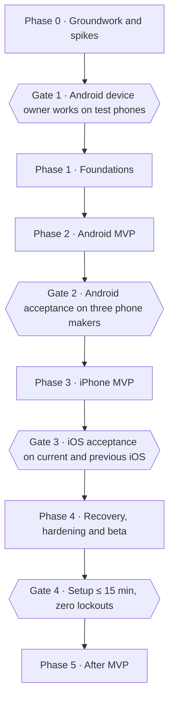

# Bannaa: Implementation Roadmap

21 Oct 2026 · Yusuf  
**Status: approved by Yusuf on 23 Oct 2026.** Work starts with Phase 0, Task 0.1.

This roadmap turns the final plan ([architecture-and-mvp-scope.md](architecture-and-mvp-scope.md)) into phases and small tasks. It follows the plan's milestones and gates, and adds how we build: version control, testing, security, data, interfaces, reviews and reporting. It does not change any product decision in [decisions.md](decisions.md).

## 1. How we work together

### The task loop

Every task follows the same loop. Nothing starts until the task before it is finished, tested and merged.

1. **Brief.** I post a short brief: what the task builds, why now, and how we will know it works. Tasks marked 🟡 also need your decision before I start.
2. **Build.** I work on a separate branch, with tests written alongside the code.
3. **Prove.** Automated checks must pass (build, lint, tests, security scans). Tasks that touch a phone also get a device check on a real phone.
4. **Report.** I open a pull request (PR) whose description is the handoff (template in Task 0.1), and send you a short report in plain language (template below).
4b. **Second review.** Codex reviews the PR as an independent reviewer. I fix each finding or reply why not, for at most two rounds; anything still disputed comes to you. Codex's comments are advice; your merge is the decision.
5. **You confirm.** You review the report, try it if the task has a "Try it" step, and merge the PR. Merging is your sign-off. It also means "go" for the next task, unless that task is marked 🟡.

At the end of each phase there is a **gate**: a short phase report, a demo you can try, and an explicit go or no-go from you.

### The task report (what you will get each time)

> **Task 1.3: Signed commands. Done ✅**  
> **What it does:** the desktop can now sign a command and a phone can check it. Fake or replayed commands are refused.  
> **How it was checked:** 48 automated tests passed, including 12 attack cases (forged, replayed, expired). Link to the PR.  
> **Try it (optional, 2 min):** …  
> **Findings / risks:** one thing worth knowing, in one or two lines.  
> **Your call:** none, or one clear question.  
> **Next:** Task 1.4, local storage.

### Who does what

| Who | Does |
| --- | --- |
| Codex | Reviews every PR independently against `AGENTS.md` and the handoff; does not push code |
| Claude | Writes the code, tests and docs; opens PRs; runs checks; writes reports; flags risks early |
| Yusuf | Approves briefs marked 🟡, reviews and merges PRs, decides at each gate; handles physical steps (plugging in phones, the spare iPhone), paid accounts (Apple Developer, Windows signing), the master key ceremony, and finding the copy reviewer and beta testers |

Code that has to run on your Mac with phones plugged in (ADB, iPhone tools, Xcode) runs there through a remote session that you approve. Everything else runs in the cloud and in CI.

### Markers used below

- 🟡 needs your decision before the task starts
- 👀 has a "Try it" step for you
- 📱 needs a real phone
- **S / M / L**: rough size (small: a day or two, medium: up to a week, large: more). These are estimates for one AI-assisted developer, not promises.

## 2. Engineering standards

These apply to every task. Task 0.1 writes them into the repo so every AI assistant follows them too.

### 2.1 Version control

- **Hosting:** GitHub, the existing private repo `youssefsaeed97/Bannaa`. One repo for everything (a "monorepo"), so a change to the command format and the code on both sides land together.
- **Branches:** `main` is always working and releasable. Every task gets a short-lived branch: `feat/agent-block-engine`, `fix/schedule-midnight`, `docs/threat-model`, `spike/ios-tiny-restore`. Branches are deleted after merging.
- **Protection on `main`:** no direct pushes; a PR, green checks and your approval are required.
- **Commit messages:** [Conventional Commits](https://www.conventionalcommits.org). Format: `type(scope): what changed`, in English, present tense.
  - Types: `feat`, `fix`, `test`, `docs`, `refactor`, `perf`, `build`, `ci`, `chore`, `security`.
  - Scopes: `desktop`, `ui`, `core`, `android-bridge`, `ios-bridge`, `agent`, `helper`, `protocol`, `signer`, `docs`, `ci`.
  - Examples: `feat(agent): suspend blocked apps when a block starts`, `fix(core): reject commands whose expiry is in the past`, `test(agent): reboot during focus session keeps the block`.
  - A commit hook checks the format.
- **Merging:** squash merge, so each task becomes one clean commit on `main` whose message is the PR title.
- **Tracking:** each task is a GitHub issue; each phase is a GitHub milestone. A PR closes its issue. This gives you one page that shows where everything stands.
- **Versions and releases:** one product version for the whole app, [Semantic Versioning](https://semver.org): `0.x` during the MVP, `1.0.0` at public launch. Git tags (`v0.3.0`) and a `CHANGELOG.md` generated from commit messages. The phone protocol has its own number (protocol v1, v2…) so old phones and new desktops can still talk.

### 2.2 Definition of done

A task is done only when all of these are true:

- [ ] The code does what the brief said, nothing more.
- [ ] Tests cover the new behaviour, including the failure and attack cases.
- [ ] All CI checks are green: build, lint, tests, secret scan, dependency and license scan.
- [ ] Arabic and English strings exist for anything a user sees, and the RTL lint passes.
- [ ] Docs are updated where behaviour changed (and `decisions.md` if a decision changed).
- [ ] No secrets, keys or personal data in the code, logs or test files.
- [ ] Device check done on a real phone if the task touches one.
- [ ] Report sent, PR merged by you.

### 2.3 Testing strategy

Tests come in layers, from fast and many to slow and few:

| Layer | What it checks | Tools | Runs |
| --- | --- | --- | --- |
| Unit | One function at a time: signing, schedule maths, the policy gate | Rust `cargo test`, Kotlin JUnit, Swift XCTest, Go `go test`, Vitest for the UI | Every commit, in CI |
| Property tests | Thousands of random inputs, e.g. "no sequence of commands loosens a block during a window" | `proptest` (Rust), `kotest` property tests | Every commit |
| Shared test vectors | The same input files must give the same answer in Rust, Kotlin and Swift (signed commands, policy decisions, schedule times) | JSON files in `protocol/test-vectors/` | Every commit |
| Contract tests | The desktop and phone agree on the message format; a format change that would break old phones is caught | `buf breaking`, a fake phone (see Docker) | Every commit |
| UI tests | Every screen in Arabic RTL and English LTR, at 200% text size and with 30%-longer fake strings | Playwright screenshot tests, Testing Library | Every commit |
| Emulator tests | The Android agent as device owner on an Android emulator | Android instrumented tests on an emulator in CI | Every PR to the agent |
| Device tests 📱 | Real phones: tamper attempts, reboots, clock changes, dead battery | Scripted ADB checks plus a written checklist | Each agent task and each gate |
| Acceptance | The plan's acceptance criteria, end to end | Checklist in `docs/acceptance/` | Each gate |
| Exploratory | A person trying to break it, and real users in the beta | You, then 20 testers | Gates 2, 3 and the beta |

Extra care where a bug would hurt most: the **policy gate, signatures, schedules and recovery** get near-complete test coverage (over 90%), property tests and mutation testing (a tool deliberately breaks the code to prove the tests notice). Elsewhere we aim for meaningful tests, not a coverage number.

**Fail-closed torture tests** are a standing test suite for the agent and helper: reboot mid-session, pull the battery, change the clock and timezone, airplane mode, kill the app, fill the storage. The block must hold every time.

### 2.4 Security

- **Threat model first.** Task 1.2 writes down who might attack (mainly the user in a weak moment, plus anyone with the phone or the computer), what they could try, and how each attempt is stopped. Every security feature traces back to it. It is reviewed again at each gate.
- **Keys:**
  - The desktop's signing key is derived from the 24 words, kept in the macOS Keychain or Windows Credential Manager, wiped from memory after use, and never written to logs.
  - On the phone, keys live in the Android Keystore or the iPhone Keychain.
  - The creator's master key lives only on an offline machine with two backups. It is created in a written "key ceremony" (Task 4.3).
- **Commands:** signed (Ed25519), with a counter, an expiry and the target phone's ID, so a command can't be replayed, delayed or sent to another phone. Tested with attack vectors.
- **Trusted keys (agreed 23 Oct):** the phone keeps a list of trusted key holders, capped at one key in the MVP, so it behaves exactly like a single desktop. Adding a key later counts as a loosening: it needs the current desktop's signature, waits out the cool-off, and is refused during any block or window or while strict mode is on. A restore or creator code replaces the list instead of adding to it. No key holder can skip the policy gate.
- **Phone link:** mutual TLS with keys pinned during the USB setup, so nobody else on the Wi-Fi can talk to the phone.
- **Secrets never in the repo:** `.gitignore` rules (already there), a secret scanner (gitleaks) before every commit and in CI, and GitHub push protection. Code-signing keys live in GitHub's encrypted secrets or on your Mac, never in files.
- **Dependencies:** automatic scans for known vulnerabilities (`cargo audit`, `govulncheck`, `npm audit`, Gradle dependency check), Dependabot updates, and a license check that fails the build on GPL or LGPL (`cargo-deny` and equivalents). A list of every component (SBOM) ships with each release.
- **Privacy:** no telemetry and no network calls except the phone link, the filter's DNS and the App Store category lookup. Logs stay on the device, contain no app usage details beyond what stats need, and are only shared if the user exports them.
- **Reviews:** a security checklist on every PR that touches keys, commands or the policy gate. Before the public launch, an independent security review of the crypto and the phone link is recommended (a paid external review; your call at Gate 4).

### 2.5 Data storage

There is **no server and no central database** in the MVP. Each device keeps its own small encrypted database.

| Where | Store | Holds |
| --- | --- | --- |
| Desktop | SQLite encrypted with SQLCipher; key in the OS keychain | Paired phones, rules, schedules, held requests, stats, settings |
| Android agent | Room (SQLite) encrypted, key in the Android Keystore | The rules it enforces, timers, the command counter, the restore counter, held requests |
| iPhone helper | App Group storage protected by iOS data protection, keys in the Keychain | Schedules, shields, the command counter, the sealed recovery kit |

- **The phone is the source of truth for rules.** That is what lets a new computer restore without losing anything. The desktop keeps a copy for display.
- **Sync-ready from day one:** every record has a random ID (UUID), an owner (the desktop key), a created and an updated time, as the plan requires.
- **Schema changes** go through numbered migration files that are tested on a copy of the previous version's data, so an update never loses rules.
- **Writes that enforce a block are atomic:** the block is saved before it is applied, so a crash in between can only leave the phone more locked, never less.

### 2.6 Interfaces (the "APIs")

Bannaa has no web backend, so it has no public web API. It has four internal interfaces, each with a written contract and tests:

| Interface | Between | How |
| --- | --- | --- |
| UI ↔ core | React screens and the Rust core | Tauri commands with TypeScript types generated from Rust, so the two can't drift apart |
| Core ↔ iOS bridge | Rust core and the Go sidecar | Versioned JSON messages over the sidecar's standard input and output |
| Desktop ↔ phone | Rust core and the Android agent or iPhone helper | Protocol Buffers messages in a signed envelope, over USB at setup and over the LAN link after that. The link is one "route" behind a common interface, so a server route can be added later without changing the messages or the phone's checks. The schema lives in `protocol/` and code is generated for Rust, Kotlin, Swift and Go |
| Recovery codes | Creator tool and phone | A short, versioned code format, the same one a future server would sign |

The desktop ↔ phone protocol is the one that matters most. It is written as `docs/protocol.md` before any code uses it, and a later server only relays the same signed envelopes.

### 2.7 Front end

- React, TypeScript (strict mode), Vite, Tailwind with logical utilities only, i18next.
- **Design before code:** you approve wireframes of the main screens (Task 2.1) before they are built. A small design system (colours, type scale, spacing, components) is built once and reused.
- Arabic RTL by default, English LTR as a full second version, IBM Plex Sans Arabic bundled. A lint rule bans `left` and `right` in styles. Latin app names wrapped in `<bdi>`.
- Accessibility: keyboard navigation, screen-reader labels, sufficient contrast, readable at 200% text size.
- The block screen on Android (Jetpack Compose) and the helper's screen (SwiftUI) follow the same design language.

### 2.8 Docker: where it helps and where it doesn't

Docker is useful here, but not for the app itself, because Bannaa runs on desktops and phones, not on servers.

**Used for:**

- **One build toolbox:** a pinned image with the exact Rust, Go, Node, Protocol Buffers and lint versions, used in CI and on your Mac, so "it works on my machine" can't happen.
- **A fake phone:** a small container that speaks the phone protocol, so the desktop's commands, retries and error handling can be tested without a phone.
- **The recovery signer:** built inside a pinned image so the exact same tool can be rebuilt and checked later (a reproducible build).

**Not used for:** the desktop app (it must be built natively on macOS and Windows), the phone apps, or device tests (Docker on a Mac can't reach USB phones). The Android emulator runs natively or in CI, not in Docker.

### 2.9 Continuous integration (CI)

GitHub Actions runs on every PR, only for the parts that changed:

- Lint and format checks, unit and property tests, shared test vectors, UI screenshot tests.
- Secret scan, vulnerability scan, license check.
- Android emulator tests for agent changes.
- macOS and Windows desktop builds on merges to `main` and for releases (Mac minutes cost 10 times more on GitHub's free plan, so not on every commit).

### 2.10 Documentation

| Doc | Purpose |
| --- | --- |
| `docs/architecture-and-mvp-scope.md`, `docs/decisions.md` | The plan and decisions (already there) |
| `docs/roadmap.md` | This file, updated as tasks finish |
| `docs/engineering.md` | The standards above, in a form AI assistants follow |
| `docs/threat-model.md` | Attacks and defences |
| `docs/protocol.md` | The desktop ↔ phone message format |
| `docs/adr/` | Short "architecture decision records": one page per technical choice, with the reason |
| `docs/acceptance/` | Device checklists and gate results |
| `docs/reports/` | Spike and gate reports |

## 3. Technical choices I made (tell me if you disagree)

These are engineering choices inside the agreed plan, not product decisions. Each gets an ADR in Task 1.2.

1. **Shared rules, written three times, tested once.** The policy gate and schedule maths run on the phone (Kotlin on Android, Swift on iPhone) and are mirrored in the desktop (Rust) to show what will happen. Instead of sharing one code library across languages, which is harder to build and debug, each side has its own small implementation and **all of them must pass the same test-vector files**. If they ever disagree, CI fails.
2. **Protocol Buffers for messages,** because it generates code for all four languages and has a tool that catches breaking changes. The signature covers the exact bytes sent, which avoids a whole class of signature bugs.
3. **Spike code is thrown away.** Phase 0 code proves things work, then production code is written properly in later phases, using what was learned.
4. **Recovery words are language-independent.** The key comes from the underlying random number, not the words, so Arabic and English phrases restore the same key. **Finding:** the standard word-list system (BIP39) has no Arabic list, so we need our own 2,048 Arabic words, chosen to be short, distinct and easy to type, and checked by a native speaker (Task 1.4).
5. **Agreed with Yusuf 23 Oct: the phone trusts a list of keys,** capped at one in the MVP (see Security). Phones already in use can later accept a server, a second computer or parent mode with an app update instead of a new setup.
6. **Agreed with Yusuf 23 Oct: the delivery route is swappable.** Wi-Fi (and USB at setup) are the first routes. A server can be added later as another route. Late or duplicate deliveries are already stopped by each command's expiry and counter, and tests prove it.

## 4. Phases and tasks

The phases follow the plan's milestones and gates. Phase 0 starts with the repo rules, then the feasibility spikes, because their results decide the rest.

The iPhone spikes (0.6 and 0.7) run in parallel with the Android work, as the plan says, because Apple's approvals take weeks.

### Phase 0: Groundwork and feasibility spikes

Goal: a safe repo, and hard answers to the riskiest questions before building for real.

| # | Task | Done when | Size | |
| --- | --- | --- | --- | --- |
| 0.1 | **Repo rules and safety nets.** Branch protection, PR and issue templates, commit-message check, secret scanner, `docs/engineering.md`, CLAUDE.md pointing to it, GitHub milestones and issues for Phase 0 and 1. **Reviewer setup (agreed 23 Oct):** `AGENTS.md` for Codex pointing to the same rules plus review guidelines (what to check first: the policy gate, signatures, fail-closed, secrets, RTL); a PR template that is the handoff (task and goal, what changed, how it was tested with results, risks and what to look at hardest, out of scope, how to try it); Codex code review turned on for the repo. | A test commit with a fake key is refused; a badly named commit is refused; a PR can't merge without checks and your approval | S | 🟡 |
| 0.2 | **Your accounts and hardware (your task, I prepare the checklist).** Apple Developer account (organisation account recommended, so the App Store shows "Bannaa", which needs a D-U-N-S number); request Apple's Family Controls permission; test phones (a Pixel first, then Samsung, Xiaomi, Oppo, Infinix); a spare iPhone. | Accounts exist; the request is sent; at least one Android phone is ready | S | 🟡 |
| 0.3 | **Spike: Android device owner on a Pixel** 📱. A throwaway agent installed over ADB, set as device owner without a wipe, applying the always-on restrictions and suspending an app. | Written report: each step works or not, with screenshots | M | 👀 |
| 0.4 | **Spike: phone makers** 📱. Same test on Samsung, Xiaomi, Oppo, Infinix: account-removal steps, device-owner setup, whether battery savers kill the agent. | A table per phone maker with the extra wizard steps each needs | M | |
| 0.5 | **Spike: the risky Android pieces** 📱. The on-phone VPN filter with family DNS and forced SafeSearch; a timer that survives reboots and clock changes; how the desktop talks to the phone over USB (Rust ADB library or Google's `adb` tool, with a license check). | Report with a recommendation for each | M | |
| 0.6 | **Spike: iPhone tiny restore** 📱 (parallel, on your Mac and the spare iPhone). Supervise without a wipe using go-ios; fall back to full restore, then erase. | Report: which method works on current iOS | L | |
| 0.7 | **Spike: iPhone helper app** 📱 (parallel). A bare Screen Time app on a supervised iPhone: does a schedule fire without the desktop; can the user delete it or switch off its access. | Report with the answer to both questions | M | |

**Gate 1 (Android):** phase report from spikes 0.3 to 0.5. You decide go, or adjust the plan. The iPhone spike results feed Gate 2 and Phase 3.

### Phase 1: Foundations

Goal: the shared base every later task stands on. Mostly invisible to users, so reports will explain why each piece matters.

| # | Task | Done when | Size | |
| --- | --- | --- | --- | --- |
| 1.1 | **Project skeleton and CI.** Folders from the planned layout, pinned toolchains, the Docker build toolbox, CI per part. | A "hello" build of each part passes CI | M | |
| 1.2 | **Threat model, protocol spec and ADRs.** `docs/threat-model.md`, `docs/protocol.md`, the first ADRs. | You have read a one-page plain summary and confirmed it | M | 🟡 |
| 1.3 | **Signed commands.** Protocol schema v1, signed envelope (version, phone ID, key ID, counter, expiry, nonce, signature), a trusted-key list capped at one, code for Rust and Kotlin, attack test vectors. | Forged, replayed, expired, wrong-phone and unknown-key commands are all refused in both languages; a second key can't be added in the MVP | M | |
| 1.4 | **Keys and the recovery phrase.** 24-word phrase → desktop key, English list plus a new Arabic list, OS keychain storage. | Same phrase gives the same key every time, in either language; native speaker has checked the Arabic list | M | 🟡 |
| 1.5 | **Policy rules as plain-language scenarios.** A table of about 40 situations ("strict mode on, user asks to allow Instagram → refused") that becomes test vectors. Covers cool-off, windows, strict mode and its countdown, retiring, restore lock, held requests, overlap. | You have confirmed every row; the vectors are in the repo | M | 🟡 👀 |
| 1.6 | **Policy gate and schedule engine (Rust reference).** One gate function plus schedule maths (weekly windows, midnight crossings, Friday-Saturday weekends, time zones). | Passes all scenario vectors, property tests and mutation testing | M | |
| 1.7 | **Local storage (desktop).** Encrypted database, data model with UUIDs and owners, migrations. | Data survives restarts; a migration test passes; the file is unreadable without the key | S | |

### Phase 2: Android MVP

Goal: a working Android product end to end. The agent comes first, then the desktop that controls it.

**Agent (phone side)**

| # | Task | Done when | Size | |
| --- | --- | --- | --- | --- |
| 2.1 | **Screen flows and wireframes** (desktop wizard, home, blocks, schedules, settings; Android block screen), Arabic first. | You have approved the wireframes and visual direction | M | 🟡 👀 |
| 2.2 | **Agent skeleton** 📱. Device-owner app, encrypted storage, status notification, Arabic and English, emulator test setup. | Installs and becomes device owner via a script; emulator tests run in CI | M | |
| 2.3 | **Always-on protection** 📱. No factory reset, safe mode, new users, clock changes, sideloading; ADB turned off after setup; can't be uninstalled. | Device check script confirms each on two phones | M | 👀 |
| 2.4 | **Block engine** 📱. Manual block, suspend apps and the Play Store, always-allowed list, overlapping blocks resolve to the strictest. | Unit tests plus a device check | M | |
| 2.5 | **Timers and schedules on the phone** 📱. Focus sessions and weekly schedules that run with the desktop off. | Fail-closed torture tests pass; a schedule starts and ends within 60 seconds of its time | L | |
| 2.6 | **Command receiver and policy gate (Kotlin)**. Checks signatures against the trusted-key list and counters, runs the gate, holds requests made during a window. | Passes the same scenario vectors as the Rust version | M | |
| 2.7 | **Explicit content filter** 📱. Always-on VPN with family DNS, forced SafeSearch, blocked-site list during blocks, Chrome's own secure DNS off, VPN setup blocked. | A known adult site doesn't load; Google, Bing and DuckDuckGo show SafeSearch results; the filter can't be turned off on the phone | L | 👀 |
| 2.8 | **Block screen and phone UI** 📱. Shown when a blocked app is opened; the phone can only tighten (start a block or session). | Screenshot tests in both languages; device check | M | |
| 2.9 | **Agent self-update.** The desktop can push a newer signed agent to the phone. | An old agent upgrades and keeps its rules; an unsigned update is refused | M | |

**Desktop (computer side)**

| # | Task | Done when | Size | |
| --- | --- | --- | --- | --- |
| 2.10 | **Desktop shell and design system.** Tauri app, Arabic and English, RTL lint, fonts, components from the wireframes, screenshot tests. | The empty app runs on Mac and Windows in both languages | M | 👀 |
| 2.11 | **USB link to Android** 📱. Detect the phone, install the agent, set device owner, exchange keys over USB. | Works on the test phones; clear Arabic errors for each failure | L | |
| 2.12 | **Setup wizard (Android)** 📱. Every step checked on the phone, phone-maker-specific steps, normal or strict mode, filter notice, recovery phrase shown and confirmed. | A first-time user finishes setup; each failure has a recovery path | L | 👀 |
| 2.13 | **Wi-Fi link, as the first route.** A common "route" interface with Wi-Fi as its first implementation; find the phone on the home network, mutual TLS, queued commands when the phone is away. | Commands arrive over Wi-Fi; a stranger on the network is refused; late and duplicate deliveries are refused (tested with the fake phone) | M | |
| 2.14 | **Control screens.** Blocks, focus presets (25, 50, 90 min, custom), schedules with Hijri dates, allow requests with cool-off, strict mode end and countdown, retire phone, stats. | Each screen works end to end with a real phone | L | 👀 |
| 2.15 | **Test builds for you.** Unsigned Mac and Windows builds you can install. | You have installed it and set up your own phone | S | 👀 |

**Gate 2 (Android MVP):** the plan's Android acceptance criteria run on three phone makers and recorded in `docs/acceptance/`. You try to break it yourself. Go or no-go for iPhone.

### Phase 3: iPhone MVP

Goal: the same features on iPhone, using the method the spikes proved. If the helper app isn't approved in time, we switch to Plan B (desktop-timed blocks) without changing anything else.

| # | Task | Done when | Size | |
| --- | --- | --- | --- | --- |
| 3.1 | **iOS bridge sidecar.** Go program on go-ios: detect, pair, list apps, install profiles; talks to the Rust core. | Contract tests pass; works with the spare iPhone | M | |
| 3.2 | **Supervision step** 📱. The method chosen at Gate 1, with the fallbacks, behind one switchable step. | Spare iPhone supervised by the desktop; fallbacks tested | L | |
| 3.3 | **Profiles.** Base and block profiles built and signed in Rust, names in the iPhone's language, filter and locked DNS. | Profile tests pass; installed profiles can't be removed | M | |
| 3.4 | **Helper app** 📱. Screen Time permission, schedules and sessions on the phone, shields, signed commands, status screen, policy gate in Swift. | Passes the shared scenario vectors; schedules fire with the desktop off | L | 👀 |
| 3.5 | **App categories.** App Store genre lookup for installed apps. | Category blocking works on iPhone | S | |
| 3.6 | **iPhone setup wizard** 📱, including the Windows Apple-driver check and the QR code for the helper. | A first-time iPhone setup completes on Mac and Windows | L | 👀 |
| 3.7 | **App Store submission** of the helper as an unlisted app. | Apple approves it | M | 🟡 |

**Gate 3 (iPhone MVP):** iOS acceptance criteria on the current and previous iOS. Go or no-go for the beta.

### Phase 4: Recovery, hardening and closed beta

Goal: safe to hand to real users.

| # | Task | Done when | Size | |
| --- | --- | --- | --- | --- |
| 4.1 | **Restore with the phrase** 📱. New computer, restore counter on the phone, 24-hour no-loosening period, takeover notice. | Restore works twice; the third is refused; rules never reset | M | 👀 |
| 4.2 | **Creator recovery codes.** The offline signer tool and the phone side: request code, one-time answer, re-key. | A code works once, only on its phone; replay and other phones are refused | M | |
| 4.3 | **Master key ceremony** (your task, with my written guide). Create the master key offline, two backups, public key built into the app. | Done and recorded, with no copy anywhere online | S | 🟡 |
| 4.4 | **iPhone sealed recovery kit** 📱. The helper holds the kit and words, sealed to the master key. | Full iPhone recovery works on the spare iPhone | M | |
| 4.5 | **Security hardening.** Threat model re-check, tamper testing on all phones, dependency and license audit, SBOM. Optional external review. | All findings fixed or accepted by you in writing | M | 🟡 |
| 4.6 | **Release pipeline.** Mac signing and notarization, Windows signing, signed auto-updates, version tags, changelog. | A signed build installs with no security warnings on Mac and Windows | M | |
| 4.7 | **Licensing** (only if Bannaa is paid). | Depends on the free-or-paid decision, which is needed before this phase | M | 🟡 |
| 4.8 | **Copy, accessibility and RTL review.** Native Egyptian copywriter, 200% text, screen readers. | Every screen passes; copy signed off | M | |
| 4.9 | **Closed beta.** 20 Arabic-speaking testers, a feedback form, a lockout watch, a support guide. | Beta report | L | 👀 |

**Gate 4 (launch readiness):** setup in 15 minutes or less, zero lockouts in the beta, all acceptance criteria green. Version `1.0.0`.

### Phase 5: After the MVP

From the plan's "Future options": prayer-time and Ramadan presets first, then several phones per desktop, parent mode with consent, and the optional server. Each gets its own short plan when we get there.

## 5. What I need from you before we start

1. **Approve this roadmap**, or tell me what to change.
2. **Confirm the rhythm:** merging a task's PR means "go" for the next task, and 🟡 tasks wait for your explicit answer. (Alternative: you say "go" before every task.)
3. **GitHub:** push the current docs to `github.com/youssefsaeed97/Bannaa` and add the repo to this project, so I can open PRs and run CI there.
4. **Start 0.2 early:** the Apple Developer account and the Family Controls request take the longest, so they are worth starting now even though iPhone work comes later.

The free-or-paid question is not needed until Phase 4.
